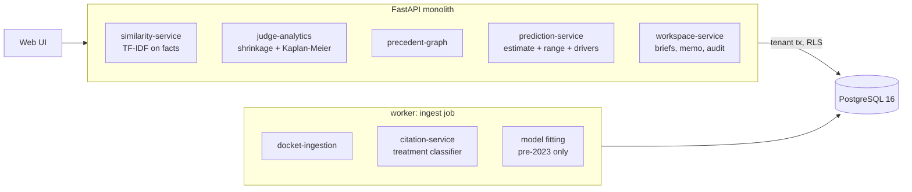

# AI Court Case & Judicial Analytics System

Analytics over court records: similar cases, how a cited case has been treated since, a judge's record with honest error bars, time
to resolution, and an estimated chance that a motion is granted with a range, the factors behind it, and a memo in which every
sentence lists its sources. It reports base rates with uncertainty. It does not claim to know what a court will do.

Built from blueprint 5 of "Advanced Project Blueprints, Volume II" as a **vertical slice**: the demo scenario end to end, with the
platform parts real and the rest listed under [Not built](#not-built-and-why).

**No court, judge, party or case here is real. Every name is invented and every ruling is drawn from a simulation, which is what allows the estimates to be checked. Nothing here is legal advice.**

## Run it

```bash
docker compose up --build        # migrates, trains the citation classifier, serves http://localhost:8205/ui/ with one worker
docker compose run --rm test     # 29 tests against a throwaway database
```

Open http://localhost:8205/ui/ and press **Run all steps**, or `make bootstrap demo`. API docs at `/docs`.
Demo tokens (local only): `firm-admin-demo`, `firm-partner-demo`, `firm-associate-demo`. Run `make reset` before a second demo run.

## The demo, step by step

1. Ingest ten years of dockets from four invented districts: 9,000 cases (1,383 still open), 36 judges, 12,555 rulings on motions, 42,921 citations classified. The outcome model learns from 9,825 rulings before 2023 and is scored on the 2,730 after.
2. Full-text search with filters: 164 employment cases about termination after a safety report.
3. A motion to dismiss with its facts and four cited cases is uploaded. Of the 40 most similar cases, 12 had this motion: 11 granted. Of the cited cases one is good, one needs caution (distinguished 4 times, followed once), one **has been overruled** (two later orders, quoted), one is not on record. Estimate: 66% granted (range 61% to 71%), against a 49% base rate. The memo has eight sourced sentences; the one statement with no source is kept out.
4. The judge's record: 61 of 114 motions to dismiss granted (54%), put at 53% with a 90% range of 46% to 61%. Half of this judge's cases close within 397 days, counting the 37 still open.
5. The precedent graph of the overruled case: every later order that cited it, with its treatment and its words.
6. The same motion before a judge appointed last year: 63%, but the range is 40% to 87%, with a warning that the estimate leans on the court average.
7. The model card: on unseen rulings, AUC 0.734 (judge's rate alone 0.722, motion base rate 0.625), calibration error 1.4%. Then the audit log, which records that a brief was analysed and nothing of what it said.

## Architecture



| Piece | How it works |
|---|---|
| Similar cases | TF-IDF (words and word pairs) over the facts, cosine similarity. |
| Citation treatment | Word n-gram TF-IDF + logistic regression: followed, distinguished, criticized or overruled. A cited case is flagged overruled if any later order says so, caution if it is criticised twice or distinguished more than followed. |
| Judge record | Empirical Bayes: a Beta prior is fitted to all judges' grant rates for a motion type, and each judge's rate is pulled towards it in proportion to how few rulings they have. Reported with a 90% credible interval. |
| Outcome model | Logistic regression on motion type, nature of suit, the judge's shrunk rate, the grant rate of the same motion in the 40 most similar cases, and four case features (no lawyer, amendments, claims, defence firm) plus one read from the facts (are the key events documented?). Trained only on rulings before 2023; a training row never sees its own outcome in the judge's record. |
| Range | 40 bootstrap refits, each also redrawing the judge's rate from its posterior: a thin record widens the range. |
| Drivers | Coefficient x (value minus average) per factor, one-hot blocks summed. |
| Time to resolution | Kaplan-Meier, so cases still open count for as long as they have been open. |
| Memo | Templated sentences, each with typed sources (judge, case, filing, model). A sentence with no source is returned separately, not in the memo. |
| Platform | Row-level security per firm, Postgres job queue, Idempotency-Key replay, hash-chained audit log, `/metrics`. |

## Data model

`migrations/002_courts.sql` follows the blueprint (cases, judges, filings, citations, motions); additions are marked `(+)`: facts
and features on cases, `indexes` (each tenant's fitted model and similarity index) and `analyses` (uploaded briefs and memos).

## API

| Method | Endpoint | Purpose |
|---|---|---|
| GET | `/v1/cases/search` | Full-text search with court, suit and judge filters; cursor-paginated |
| GET | `/v1/cases/{id}/similar` | Cases with the most similar facts |
| GET | `/v1/judges/{id}/analytics` | Shrunk grant rates with intervals, time to ruling, time to resolution |
| POST | `/v1/briefs/analyze` | Similar cases, cited-case check, judge record, estimate and sourced memo; stored in the firm's workspace |
| GET | `/v1/precedent/graph` | What a case cites and who has cited it since, with treatment |
| POST | `/v1/motions/estimate` | The estimate alone; nothing stored |
| POST | `/v1/dockets/ingest` | (+) 202 + job: load, classify, fit |
| GET | `/v1/models/motion-outcome` · `/v1/judges` | (+) Held-out performance and calibration; judge list |

Contract: [`docs/openapi.json`](docs/openapi.json).

## Measured

[`docs/evaluation.md`](docs/evaluation.md) (`python -m ca.evaluate`, six court systems the demo never uses) and [`docs/performance.md`](docs/performance.md).

| Component | Result | Baseline |
|---|---|---|
| Outcome model on 10,762 later rulings (AUC / Brier) | 0.741 / 0.2062 | judge's shrunk rate 0.727 / 0.2110; motion base rate 0.650 / 0.2308 |
| The ceiling (the simulator's true probability) | 0.788 / 0.1873 | |
| Calibration error | 1.1% (1.9% for plaintiffs without a lawyer) | |
| Stated 80% range containing the true probability | 39.5% | should be 80% |
| Median time to resolution, error against truth | 0.8% | median of closed cases only: 10.2% |
| Similar cases sharing the hidden fact pattern | 100% | random same-suit cases: 20% |
| Citation treatment, 4 classes | 100.0% | keyword rules 69.8% |

Similarity and treatment are perfect because the text comes from phrase banks. The model is modest by construction: outcomes are
coin flips around a probability, so even knowing that probability exactly gives AUC 0.788.

## The hardest tradeoff

What an honest range is. The blueprint asks for "uncertainty-calibrated" estimates. The probabilities are calibrated: when the
model says 70%, about 70% are granted (error 1.1%). The range around each estimate is not, and cannot be in the way a user would
assume: in simulation it contained the true probability only 39.5% of the time, because bootstrap resampling measures how unsure the
model is about its own coefficients, not how much the case depends on things the model never sees (here, the strength of the claim).
On real dockets the true probability is never observable, so that shortfall could not even be measured. I kept the range because it
does one useful thing (it widens sharply for a judge with no record: 40% to 87% against 61% to 71%) and labelled it everywhere as
what it is. Widening it by a fudge factor to hit 80% in simulation would have looked better and meant less.

## Threat model (summary)

| Threat | Mitigation here | Gap |
|---|---|---|
| A client's confidential facts leaking | Brief text is stored only in the firm's tenant (row-level security, tested with a second firm); never written to the audit log (tested) or request logs | Not encrypted at field level |
| An estimate mistaken for a prediction or advice | Every estimate carries a range, its drivers, warnings and a fixed caveat; the model card shows held-out calibration and simpler baselines | No required acknowledgement step |
| Relying on bad law | Each cited docket is checked for later negative treatment, quoted from the later order | Treatment comes from a classifier trained on template sentences |
| Invented support in the memo | No language model; every sentence carries typed sources; unsourced statements are excluded and listed | |
| Unfairness across party types | Calibration is reported separately for plaintiffs without a lawyer | One group only; no other protected attribute is modelled |
| Injection through search | Query text is a bound parameter to `websearch_to_tsquery` | |

## Not built, and why

- **Real court data** (CourtListener/RECAP, PACER exports): a deterministic simulator stands in. Real dockets carry no ground-truth probability, and profiling real, named judges from a portfolio project would be the wrong thing to publish.
- **Document parsing and segmentation**: facts arrive as text; there are no PDFs.
- **A language model / RAG with pin citations**: the memo is templated from records; sources are record ids, not page cites.
- **Embeddings**: similarity is TF-IDF, which is enough for phrase-bank facts and would not be for real pleadings.
- **Docket monitoring, appeals, multi-judge panels, partial grants**: not modelled; a ruling is granted or denied.
- **Kafka, Redis, OpenTelemetry, Grafana, MLflow, Terraform, CI, SSO, a Next.js front end**: not needed to prove the slice; no cloud account used.

## Commercial sketch

Buyer: law firms, insurers, corporate legal teams, litigation finance. Pricing shape from the blueprint: per-seat research
subscription, firm-wide contracts, an analytics API, a docket-monitoring module.

## Layout

```
core/        platform kit: db + RLS, jobs, audit chain, HTTP, scenario runner, load test
ca/          world (synthetic courts), engine (similarity, treatment, shrinkage, model, Kaplan-Meier), train, api, seed, evaluate, make_scenario
migrations/  forward-only SQL          web/   UI, scenario.json, demo.json (recorded run)
tests/       29 tests                  docs/  evaluation.md, performance.md, openapi.json
```
